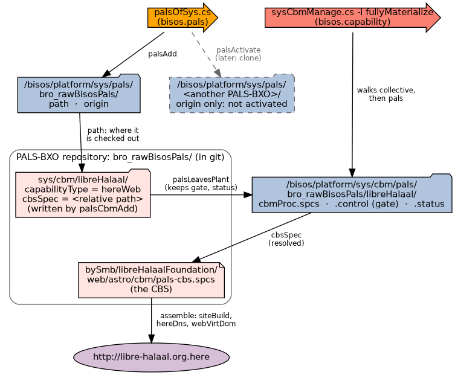

#+title: bisos.pals: Possession Assertable Libre Services
#+DATE: <2024-02-19 Mon 16:27>
#+AUTHOR: Mohsen BANAN
#+OPTIONS: toc:4

#+BEGIN: b:org:pypi:readme/topControls :pkgName "pals" :comment "basic"
#+END:

* Overview

/bisos.pals/ manages BISOS Possession Assertable Libre Services (PALS) on a platform. It keeps the
list of the PALS-BXOs a platform has, the CBMs (capabilities) each PALS-BXO declares, and the platform's
CBM leaves planted from those declarations, which BISOS's CBM walk materializes. It gives each PALS site
a =.here= name on a loopback address, and provides the generic files a PALS site's =cbm/= links to, so
that a site such as =libre-halaal.org.here= is built, named and served the same way on any platform.

* Table of Contents     :TOC:
- [[#overview][Overview]]
- [[#part-of-bisos--bystar-internet-services-operating-system][Part of BISOS — ByStar Internet Services Operating System]]
- [[#bisospals-is-a-command-only-pycs-facility][bisos.pals is a Command-Only PyCS Facility]]
- [[#bisos-possession-assertable-libre-services-pals][BISOS Possession Assertable Libre Services (PALS)]]
- [[#pals-on-a-platform-pals-bxos-and-their-cbms][PALS on a Platform: PALS-BXOs and Their CBMs]]
- [[#pals-here-names][PALS .here Names]]
- [[#installation][Installation]]
  - [[#with-pip][With pip]]
  - [[#with-pipx][With pipx]]
- [[#usage][Usage]]
  - [[#pals-bxos-and-their-cbms-palsofsyscs][PALS-BXOs and Their CBMs: palsOfSys.cs]]
  - [[#here-names-palshereinfocs][.here Names: palsHereInfo.cs]]
  - [[#a-pals-sites-cbm-the-generic-files][A PALS Site's cbm/: the Generic Files]]
- [[#key-files][Key Files]]
- [[#documentation-and-blee-panels][Documentation and Blee-Panels]]
- [[#support][Support]]
- [[#planned-improvements][Planned Improvements]]

* Part of BISOS — ByStar Internet Services Operating System

Layered on top of Debian, *BISOS* (By* Internet Services Operating System)
is a unified and universal framework for developing both internet services and
software-service continuums that use internet services. See
[[https://github.com/bxGenesis/start][Bootstrapping ByStar, BISOS and Blee]]
for information about getting started with BISOS.

*BISOS* is a foundation for *The Libre-Halaal ByStar Digital Ecosystem* which
is described as a cure for losses of autonomy and privacy in a book titled:
[[https://github.com/bxplpc/120033][Nature of Polyexistentials]]

/bisos.pals/ is part of BISOS. It is a standalone package that can
be used independently of the full BISOS environment.

* bisos.pals is a Command-Only PyCS Facility

bisos.pals is a command-line tool. It is a PyCS single-unit
command service. PyCS is a framework that converges development of CLI tools
and services. PyCS is an alternative to FastAPI, Typer and Click.

bisos.pals uses the PyCS-Framework to:

1) list a platform's PALS-BXOs, declare their CBMs and plant the platform's CBM leaves (=palsOfSys.cs=)
2) give each PALS site a =.here= name on a =127.0.55.x= address in =/etc/hosts= (=palsHereInfo.cs=)
3) provide the generic CBS, assemble, dns and vhost files a PALS site's =cbm/= links to

The core of PyCS-Framework is the /bisos.b/ package (the PyCS-Foundation).
See [[https://github.com/bisos-pip/b][bisos.b]] for an overview.

* BISOS Possession Assertable Libre Services (PALS)

Based on capabilities of BPOs and the capabilities of service-side
profiled Debian packages, we can now create Libre Services.

BISOS Libre Services can be thought of four parts:

1. Libre-Halaal software of the services (usually a Debian Package)

2. Configuration information for the software for the service (often as
   a repo of a PALS-BPO)

3. Names and numbers for binding of services (as a repo of a PAAI-BPO)

4. Service owner data (in the form of one or more BPOs)

This model provides for portability and transferability of Libre
Services between network abodes. For example, a Libre Service at a
provider can be transferred to its owner to be self-hosted.

There are some similarities between PALS-BPO and container
virtualization (Docker and Kubernetes). PALS-BPOs include comprehensive
information for construction of services and these can be mapped to
container virtualization. However, at this time BISOS does not use
container virtualization, as it is redundant. BISOS uses BPOs to create
and recreate Kernel-based Virtual Machines (KVM) inside of which
PALS-BPOs are deployed.

Self-hosting is the practice of running and maintaining a Libre Service
under one's own full control at one's own premise. BISOS Possession
Assertable Libre Services (PALS) can be initially self-hosted and then
transferred to a Libre Service provider. PALS can also be initially
externally hosted and then become self-hosted on demand. The concept of
"transferability" between network abodes is well supported in BISOS.

* PALS on a Platform: PALS-BXOs and Their CBMs

A platform may hold many PALS-BXOs, and each PALS-BXO may have many CBMs (Capability Bundle
Materializations: a capability installed, configured and running on this host). Some PALS-BXOs may be
known to the platform without being activated yet (not cloned from GitLab). The model keeps two kinds of
information apart:

- What a PALS-BXO *declares* is in its own repository: the same on every host, and it travels with the
  repository.
- What a *host* decides and observes --- which PALS-BXOs it has, whether each CBM is active here
  (its gate), and what happened when it last ran (its status) --- is on the platform, in
  =/bisos/platform/sys/=. Kept in a shared repository, host state would make every materialization
  a commit.

| Fill / shape     | Meaning                                                             |
|------------------+---------------------------------------------------------------------|
| pink (mistyrose) | declared in the PALS-BXO's repository                               |
| blue (steelblue) | host state, on the platform                                         |
| dashed           | a PALS-BXO the platform knows of but has not activated (not cloned) |
| orange arrow     | the bisos.pals tool that writes the lists and plants the leaves     |
| salmon arrow     | bisos.capability's CBM walk, which materializes the leaves          |
| lavender ellipse | the outcome: the PALS's site                                        |

The figure's example is the Libre-Halaal Foundation's site, =libre-halaal.org.here=, from the
PALS-BXO =bro_rawBisosPals=. Top down:

1. =/bisos/platform/sys/pals/<palsBxo>/= lists the PALS-BXOs of this platform, one FileParams directory
   each: =path/value= (where it is checked out; absent when not activated) and =origin/value= (where to
   clone it from).
2. =<palsBxo>/sys/cbm/<cbmName>/= declares a CBM of that PALS-BXO: =capabilityType/value= (e.g.
   =hereWeb=) and =cbsSpec/value=, its CBS as a path *relative* to the PALS-BXO (hosts check out at
   different paths). Entries are named by capability (=libreHalaal=).
3. From those declarations, standard CBM leaves are planted on the platform, in the =pals= realm:
   =/bisos/platform/sys/cbm/pals/<palsBxo>/<cbmName>/= with =cbmProc.spcs= (the resolved cbsSpec),
   =cbmProc.control= (the gate: enabled, available or disabled; available to start) and =cbmProc.status=.
   Planting is idempotent and never overwrites a gate or a status.
4. The CBM walk (=sysCbmManage.cs -i fullyMaterialize=) materializes the =pals= realm after the
   =collective= one (which brings nginx and Node). A leaf runs its CBS by the path it is planted at;
   for an Astro site, its assemble builds the site and installs the =.here= name and the nginx vhost.

Because the leaves are standard CBM leaves, the existing walker and the =cbm_*= verbs work on them
unchanged. =platform.here= is built last in =collective=, so its snapshot shows a =pals= leaf's previous
outcome.

* PALS .here Names

A PALS whose site has =uri/here/value= (e.g. =libre-halaal.org.here=) gets a loopback address in
=/etc/hosts=, as bisos.banna's services get theirs (=127.0.22.x=). PALS are not known in advance, so
their names are kept in a host-local list, =/bisos/var/palsHere/uri.list=, one line each:

#+begin_example
127.0.55.1  libre-halaal.org.here  # pals=<the PALS directory> added=2026-10-18
#+end_example

- An address is assigned once, when its name is added, and stored in its line. It is never renumbered
  and never reused: a retired name's line is commented out, not deleted.
- =palsHereInfo.cs -i palsForEtcHosts= prints the list as the body of the =palsHere= dblock of
  =/etc/hosts=. bisos.dnsCap creates that dblock when absent and fills it, beside banna's.
- =palsHere.palsHereIpOf(name)= gives a vhost its address without =/etc/hosts= having to be current.

* Installation

The sources for the bisos.pals pip package are maintained at:
https://github.com/bisos-pip/pals.

The bisos.pals pip package is available at PYPI as
https://pypi.org/project/bisos.pals

You can install bisos.pals with pip or pipx.

** With pip

If you need access to bisos.pals as a python module, you can install it with pip:

#+begin_src bash
pip install bisos.pals
#+end_src

** With pipx

If you only need access to bisos.pals on command-line, you can install it with pipx:

#+begin_src bash
pipx install bisos.pals
#+end_src

The commands of the current model are =palsOfSys.cs= and =palsHereInfo.cs=, and the four generic files
a PALS site's =cbm/= links to (=pals-cbs.spcs=, =pals-assemble.cs=, =pals-here-dns.spcs=,
=pals-wvd.spcs=). The earlier PALS-BPO commands are also installed: =palsBpoManage.cs=,
=palsRepoProfile.cs=, =palsRepoLiveParams.cs=, =palsBaseLiveTargets.cs=, =palsSiGeneweb.cs= and
=palsSivdApache2.cs=.

=pals-here-dns.spcs= needs /bisos.dnsCap/ and /bisos.csSeed/; =pals-cbs.spcs= needs /bisos.capability/;
=pals-wvd.spcs= needs /bisos.webCap/.

* Usage

** PALS-BXOs and Their CBMs: palsOfSys.cs

| Command           | What it does                                                         |
|-------------------+----------------------------------------------------------------------|
| =palsList=        | each PALS-BXO, activated or not, with its CBMs and their gates       |
| =palsAdd=         | list a PALS-BXO on this platform (=<bxoPath> [--origin=<url>]=)      |
| =palsCbmsList=    | the CBMs PALS-BXOs declare (=[<palsBxo> ...]=)                       |
| =palsCbmAdd=      | declare a CBM (=<palsBxo> <name> <cbsRelPath> --capabilityType=...=) |
| =palsLeavesPlant= | plant or refresh the platform's leaves from the declarations         |

The Libre-Halaal Foundation's site, from the PALS-BXO =bro_rawBisosPals=:

#+begin_src bash
palsOfSys.cs -i palsAdd /bxRepos/bxObjects/bro_rawBisos/bro_rawBisosPals    # origin: its git remote
palsOfSys.cs -i palsCbmAdd bro_rawBisosPals libreHalaal \
    bySmb/libreHalaalFoundation/web/astro/cbm/pals-cbs.spcs                 # --capabilityType=hereWeb
palsOfSys.cs -i palsLeavesPlant                                             # gate: available
palsOfSys.cs -i palsList
cd /bisos/platform/sys/cbm/pals/bro_rawBisosPals/libreHalaal
./cbmProc.spcs -i cbm_enable                       # then the CBM walk materializes it
cd /bisos/platform/sys/cbm/pals && ./ftoBranchProc.spcs -i fto_forwardToLeaves --cmndName=cbm_materialize
#+end_src

** .here Names: palsHereInfo.cs

#+begin_src bash
palsHereInfo.cs -i palsHereList                              # every name, with where it came from
palsHereInfo.cs -i palsHereIpOf libre-halaal.org.here        # its 127.0.55.x address
palsHereInfo.cs -i palsHereAdd <palsDir>                     # add by hand (the CBS's assemble does it)
palsHereInfo.cs -i palsForEtcHosts                           # the palsHere dblock's body
#+end_src

** A PALS Site's cbm/: the Generic Files

A PALS site's =cbm/= holds only symlinks to four generic files in this package's =py3/bin/=. Each takes
its parameters from where it is planted: the PALS is the nearest directory above it with
=uri/here/value=. The path is never resolved, so a symlink finds its own PALS.

| File                 | What it is                                                                   |
|----------------------+------------------------------------------------------------------------------|
| =pals-cbs.spcs=      | the CBS: no sbom, no units; its assemble is the =pals-assemble.cs= beside it |
| =pals-assemble.cs=   | siteBuild (=astroProc.spcs=), hereDns, webVirtDom                            |
| =pals-here-dns.spcs= | adds the name to the list, then updates =/etc/hosts= (=dnsCap_update=)       |
| =pals-wvd.spcs=      | the nginx vhost: server_name from =uri/here=, root =<PALS>/site/dist=        |

#+begin_src bash
cd <palsSite>/cbm
for f in pals-cbs.spcs pals-assemble.cs pals-here-dns.spcs pals-wvd.spcs; do
    ln -s /bisos/git/bxRepos/bisos-pip/pals/py3/bin/$f $f
done
./pals-assemble.cs -i fullUpdate                   # siteBuild + hereDns + webVirtDom
#+end_src

* Key Files

In =py3/bisos/pals/=:

| File               | What it is                                                        |
|--------------------+-------------------------------------------------------------------|
| =palsOfSys.py=     | the PALS-BXO list, the CBM declarations, leaf planting            |
| =palsOfSys_csu.py= | the =palsOfSys.cs= commands                                       |
| =palsHere.py=      | the =.here= list, address assignment, =palsHereIpOf=, plant paths |
| =palsHere_csu.py=  | the =palsHereInfo.cs= commands                                    |

=py3/bin/= holds =palsOfSys.cs=, =palsHereInfo.cs= and the four generic =pals-*= files;
=py3/images/palsModel-graphviz.pcs= draws the figure above (=palsModel.png=, =.pdf=, =.svg=).

The other modules of =py3/bisos/pals/= (=palsBpo.py=, =palsRepo.py=, =palsSis.py=, the =si*.py= service
instances, ...) are the earlier PALS-BPO model, kept and under review.

* Documentation and Blee-Panels

bisos.pals is part of ByStar Digital Ecosystem [[http://www.by-star.net]].

This module's primary documentation is in
[[http://www.by-star.net/PLPC/180047]]

Its Blee-Panel is at [[file:./py3/panels/bisos.pals/_nodeBase_/fullUsagePanel-en.org]].

* Support

For support, criticism, comments and questions; please contact the
author/maintainer\\
[[http://mohsen.1.banan.byname.net][Mohsen Banan]] at:
[[http://mohsen.1.banan.byname.net/contact]]

* Planned Improvements

** TODO =palsActivate=: clone a PALS-BXO that the platform lists but has not activated (its origin)
** TODO =platform.here= reads a =pals/<palsBxo>/<cbmName>/= leaf as realm/type/name: teach it that shape
** TODO setup.py (Blee): the new scripts; bisos.dnsCap, bisos.csSeed, bisos.capability in requires
** TODO Review the earlier PALS-BPO commands and modules against the current model
